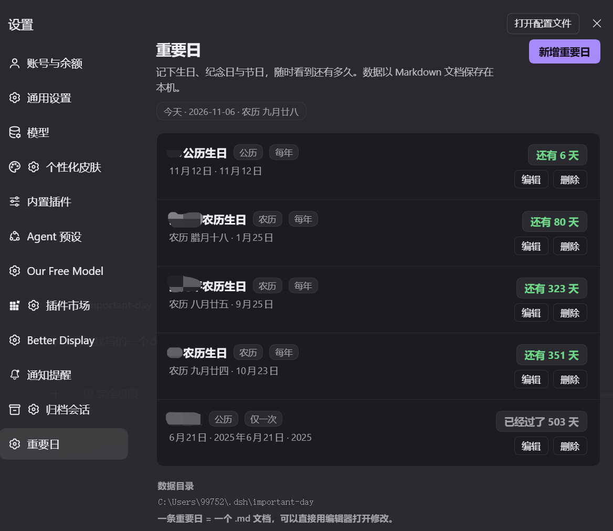

<div align="center">


# 重要日 · Important Days

**在 DeepSeek Harness 的设置面板里，记下对你有意义的日子。**

公历 / 农历双历法 · 生日 · 纪念日 · 节日 · 一条记录 = 一个 Markdown 文档

[](https://nodejs.org)
[](LICENSE)
[](#设计取舍)

</div>

---



> 设置 → 重要日：今天（含农历）→ 还有 6 天 / 还有 80 天 / 已经过了 503 天，一眼看完。

---

## 这是什么

`重要日` 是一个 **DeepSeek Harness（DSH）** 插件。它向设置面板贡献一个「重要日」页面，用来记录生日、纪念日与节日——**支持中文农历**，并实时算出距离每个日子还有多久、或者已经过去了多久。

所有数据都是**你自己机器上的普通 Markdown 文件**，没有云端、没有数据库、没有账号。想改？直接用任何编辑器打开那个 `.md` 文件。

## 特性

- **公历 + 农历** — 农历换算走运行环境自带的 ICU（CLDR）中文历，不锁定年份、不引第三方农历库
- **闰月支持** — 可以标记「闰四月」这类闰月；该年没有这个闰月时按同号平月计算，并给出提示
- **两种计数模式**
  - 勾选「包含年份」→ **一次性日期**：显示「还有 N 天」/「就是今天」/「已经过了 N 天」
  - 不勾选 → **每年重复**：永久滚动到下一次，永远显示「还有 N 天」
- **数据即文档** — 一条记录 = 一个 `.md`，YAML 头部 + 正文，人可读、可手改、可放进自己的笔记仓库
- **零运行时依赖** — 除宿主已提供的 React 外不依赖任何包，也没有构建步骤
- **跟随主题与语言** — 只用 `--dsw-alias-*` 主题 token，明暗主题自动适配；内置中英双语
- **并发安全** — 文档带 `rev` 版本号做乐观并发，多窗口同时编辑会得到 409 提示而不是静默覆盖
- **优雅降级** — 运行环境是 small-icu（不含中文历）时明确提示不可用，绝不返回一个算错的日期

## 安装

```bash
git clone https://github.com/0x7c11/dsh-important-day.git
```

然后在你的 dsh profile 的 `package.json` 里做两件事。

**1) 声明依赖**（路径换成你本机的实际位置）：

```jsonc
{
  "dependencies": {
    "@local/dsh-important-day": "link:D:/path/to/dsh-important-day"
  }
}
```

**2) 加入 bundles 列表**，让它的 `cordis.patch.yml` 生效：

```jsonc
{
  "dsh": {
    "profile": {
      "bundles": [
        "@local/dsh-important-day"
      ]
    }
  }
}
```

重装 profile 依赖并重启 dsh，即可在 **设置 → 重要日** 看到它。

> **环境要求**：Node.js ≥ 18。要用农历请使用**完整 ICU** 的 Node 构建（官方安装包、Node 22 均默认完整 ICU）。若页面提示「当前运行环境的 ICU 不含中文历」，说明当前是 small-icu 构建。

## 使用

| 操作 | 说明 |
| --- | --- |
| **新增重要日** | 右上角按钮，填写标题、选择公历/农历、选日期 |
| **一次性 vs 每年** | 「包含年份」开关：勾选会显示已经过去的天数，不勾选则每年循环 |
| **正文** | 可选字段，用来记礼物清单、约定地点、注意事项……多行原样保留 |
| **编辑 / 删除** | 每条右侧；删除会二次确认 |
| **查看数据目录** | 页面底部直接展示当前 `.md` 文件所在的绝对路径 |

列表按 **今天 → 未来（越近越前）→ 已过去（越近越前）→ 无法解析** 排序。

## 数据格式

默认目录：`%DSH_HOME%/important-day/`（Windows 下即 `C:\Users\<你>\.dsh\important-day`），一条记录一个文件：

```markdown
---
id: 20261104-b2rfw6
title: "农历生日"
calendar: lunar
withYear: false
year: 0
month: 8
day: 25
leap: false
rev: 0
createdAt: "2026-11-04T21:14:48.797+08:00"
updatedAt: "2026-11-04T21:14:48.797+08:00"
---

正文内容写在这里，可以是多行，也可以留空。
```

- `calendar`：`solar`（公历）或 `lunar`（农历）
- `withYear`：`true` = 一次性日期，`false` = 每年重复
- `leap`：农历闰月
- `rev`：修改计数，用于乐观并发（**不要手动改小它**）

外部编辑器改完文件后，切回页面（或切回浏览器标签）会自动重新读取，无需重启 dsh。
格式有问题的文件会被跳过并在页面上提示，不会影响其他记录。

## 配置

想换数据目录，在 **profile 的** `cordis.patch.yml` 里用同一个 id 覆盖 config：

```yaml
- id: important-day
  config:
    dataDir: 'D:/我的重要日'
```

| 字段 | 默认值 | 说明 |
| --- | --- | --- |
| `dataDir` | `%DSH_HOME%/important-day` | 存放 `.md` 文档的目录，留空即默认 |

> 注意：loader 是**整体替换** config 而非深合并，覆盖时请把需要的字段都写上。

## 工作原理

插件分两个半身，通过宿主已鉴权的 `/api` 共享通道通信：

```
 ┌──────────────────────────┐         ┌──────────────────────────┐
 │  Client 半身 (client.js) │  fetch  │  Host 半身 (index.js)    │
 │  设置 → 重要日           │ ──────► │  /api/important-day/*    │
 │  手写 ModuleLoader bundle│ ◄────── │  lib/ · Node 原生        │
 └──────────────────────────┘   JSON  └────────────┬─────────────┘
                                                   │
                                          ┌────────▼─────────┐
                                          │  *.md 文档       │
                                          │  (数据即事实来源) │
                                          └──────────────────┘
```

| 接口 | 方法 | 用途 |
| --- | --- | --- |
| `/api/important-day/list` | GET | 读取全部记录，附带已算好的天数 / 相位 / 农历描述 |
| `/api/important-day/save` | POST | 新增或更新（带 `rev` 乐观并发校验） |
| `/api/important-day/remove` | POST | 删除一条 |

路由通过 `ctx.connection.fetch.register` 注册——宿主会先做 cookie / trust 准入，只把 owner 主体的请求交给处理器，因此插件不必自己复刻一套信任围栏。

| 文件 | 职责 |
| --- | --- |
| `index.js` | Host 入口：路由、参数校验、读写编排 |
| `lib/lunar.js` | 农历 ↔ 公历换算（ICU 中文历，纯函数） |
| `lib/countdown.js` | 天数 / 相位计算与文案（纯函数） |
| `lib/store.js` | Markdown 文档存储（Front matter 读写、id 校验） |
| `client.js` | 设置面板页面（手写 bundle，无构建） |
| `cordis.patch.yml` | bundle patch，挂载 Host 半身 |
| `locale/*.json` | 中英文插件元信息 |

## 开发

```bash
npm test
```

测试全部基于 Node 原生 `assert`，**不依赖任何测试框架**，也不需要启动 dsh：

| 测试 | 内容 |
| --- | --- |
| `run-tests.mjs` | 单元测试：农历换算、天数/相位、文档存储（42 项） |
| `host-smoke.mjs` | 用假 cordis Context 跑通三个路由的完整读写链路 |
| `client-static.mjs` | Client bundle 注册形态与仓库约定 |
| `client-render.mjs` | 最小 React 桩驱动真实 `client.js` 的渲染冒烟 |
| `client-interaction.mjs` | 会重渲染的 React 桩，覆盖表单与点击路径（含 409 重试） |
| `lunar-guard.mjs` | 模拟 small-icu，验证中文历不可用时降级而非算错 |
| `verify-fixes.mjs` | 对历史复核问题的独立回归验证 |
| `e2e-sim.mjs` | 端到端仿真：新增 → 列表 → 文档，打印真实链路结果 |

## 设计取舍

- **不用第三方农历库** — Node 的完整 ICU 已内置 CLDR 中文历，数据随系统更新且不会锁死在某一年；常见 npm 库要么锁年份、要么体积很大。
- **不引 YAML 解析器** — 只读回自己写出的扁平 `key: value` 头部，手改文档不必和缩进规则搏斗。
- **不建索引、不写 session event** — 文档本身就是事实来源，每次 `list` 重新读目录，外部改动立刻可见。
- **不用 `webServer.register`** — 那会绕过宿主对 `/api` 的准入判定（最长前缀优先），得自己复刻信任围栏；`connection.fetch` 由宿主先做准入。
- **所有日期走 UTC 零点** — 把「日历日」和「时刻」分开，避免本机时区 / 夏令时造成跨天误差。

## License

[MIT](LICENSE) © 2026 0x7c11
